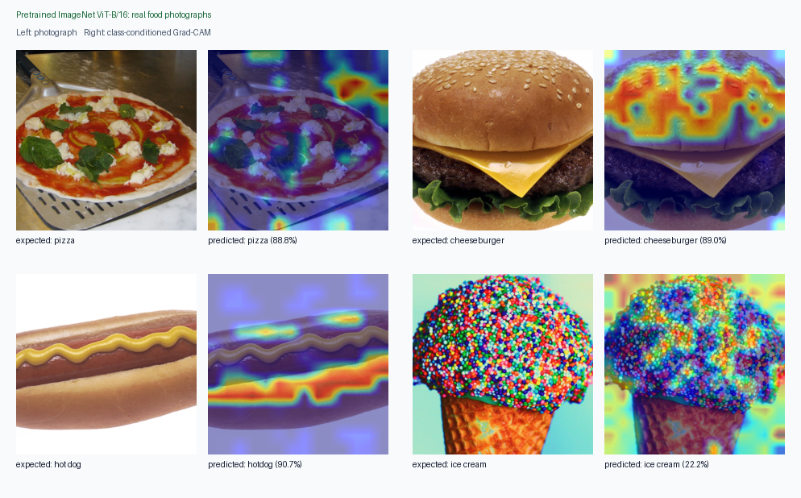

# Grad-CAM for Vision Transformers

Following the model-visualization direction established by Zeiler and Fergus in
[*Visualizing and Understanding Convolutional Networks*](https://arxiv.org/abs/1311.2901),
this repository adapts the usual Grad-CAM calculation to a Vision Transformer
(ViT). The key difference is spatial reconstruction: a ViT layer emits a token
sequence instead of a convolutional feature map, so the class token is removed
and the patch tokens are reshaped back into their 2-D grid.

For torchvision's ViT-B/16 at 224 x 224 pixels:

```text
[batch, 197 tokens, 768 channels] -- remove class token --> [batch, 196 patches, 768 channels] -- reshape 196 = 14 x 14 --> [batch, 768 channels, 14, 14]
```

Each of the 196 patch tokens represents one 16 x 16 input region. Restoring
their 14 x 14 order recovers the image's spatial layout without changing the
learned token values or their 768-channel embeddings.

Grad-CAM then works normally: spatially average the gradients to obtain one
weight per channel, compute the weighted activation sum, apply ReLU, upsample,
and normalize.

## Example output

The pretrained ImageNet ViT-B/16 correctly predicts all four real food
photographs. Each source image is shown beside its class-conditioned Grad-CAM:



## Run the demo

Python 3.10+ is recommended.

```powershell
python -m pip install -r requirements.txt
python demo.py --image path/to/image.jpg --output gradcam_overlay.png
```

The first run downloads torchvision's pretrained ViT-B/16 weights. You can run
the plumbing offline with a generated image and random weights, though that
heatmap is not semantically meaningful:

```powershell
python demo.py --weights none
```

Use `--target-class 243` to explain a specific ImageNet logit instead of the
model's top prediction. Run `python demo.py --help` for all options.

To generate a four-example contact sheet with predicted classes and confidence:

```powershell
python gallery.py --weights default
```

## Use the reusable class

```python
from torchvision.models import ViT_B_16_Weights, vit_b_16

from gradcam_vit import ViTGradCAM, torchvision_vit_b_16_target_layer

model = vit_b_16(weights=ViT_B_16_Weights.DEFAULT).eval()
target_layer = torchvision_vit_b_16_target_layer(model)

with ViTGradCAM(model, target_layer) as gradcam:
    cams, logits, target_classes = gradcam(input_batch)
```

For a rectangular grid or a model with a different number of prefix tokens,
provide a small reshape callback:

```python
from functools import partial
from gradcam_vit import tokens_to_spatial

reshape = partial(tokens_to_spatial, grid_size=(14, 20), num_prefix_tokens=1)
with ViTGradCAM(model, target_layer, reshape_transform=reshape) as gradcam:
    cams, logits, targets = gradcam(input_batch)
```

The target layer matters. For torchvision ViTs, the first LayerNorm in the last
encoder block (`model.encoder.layers[-1].ln_1`) keeps useful patch-token
gradients while remaining close to the classifier output.

## Verify

```powershell
python -m unittest discover -s tests -v
```
